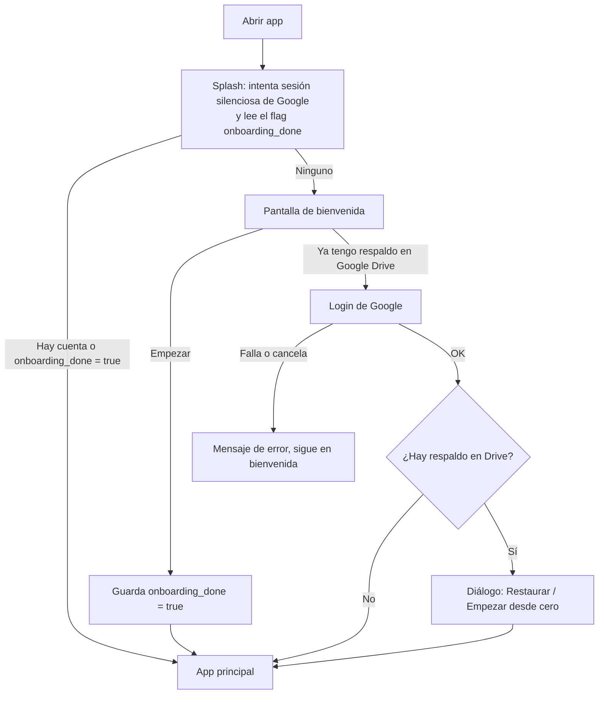

# Flujo de la app — MotoCheck

> Qué ve el usuario y qué pasa exactamente al pulsar cada botón. Extraído del código (v1.0.0+3). Si cambias un flujo, actualiza este documento.

## 1. Arranque

- Al entrar a la app principal siempre se guarda `onboarding_done = true`, así que cerrar sesión después **no** devuelve a la bienvenida.
- También al entrar: se pide permiso de notificaciones (Android 13+) y se sincronizan los recordatorios.

## 2. Navegación principal

Barra inferior con 5 pestañas (se conservan en memoria al cambiar de pestaña):

| # | Pestaña | Contenido |
|---|---|---|
| 1 | Inicio (Dashboard) | Moto activa, último km/L, próximo servicio, alertas de refacciones |
| 2 | Mantenimientos | Lista de servicios + botón "Agregar servicio" |
| 3 | Combustible | Resumen, gráfica, comparativa, filtros, lista + botón "Registrar carga" |
| 4 | Refacciones | Lista con progreso, historial de cambios + botón "Nueva refacción" |
| 5 | Configuración | Google Drive, moneda, información |

Todas las pestañas muestran solo los datos de la **moto activa**.

## 3. Primeros pasos (Inicio)

Con una moto registrada, Inicio muestra la tarjeta **Primeros pasos** (x de 3) hasta completarla o descartarla (clave `getting_started_dismissed`):

1. Carga las refacciones de tu moto → pestaña Refacciones
2. Registra tu última carga de gasolina → pestaña Combustible
3. Registra tu último servicio → pestaña Mantenimientos

La tarjeta de alertas de refacciones no se muestra mientras no haya refacciones (no dice "Todo en orden" sin nada que vigilar).

## 3b. Motos (desde Inicio)

| Acción | Qué pasa |
|---|---|
| Sin motos registradas | Inicio muestra "Agrega tu primera moto" con el botón **Agregar mi moto**. Los botones de agregar de las otras pestañas avisan "Primero agrega tu moto en la pestaña Inicio" |
| Guardar sin marca o modelo | Aviso "Indica la marca y el modelo de tu moto" |
| Botón cambiar/agregar moto | Hoja inferior con la lista de motos: **Activar**, **Eliminar** o **Agregar nueva moto** |
| Agregar moto → Guardar | Inserta la moto; si no había moto activa, la nueva queda activa y adopta cualquier registro guardado sin moto (datos de versiones anteriores) |
| Editar (lápiz) → Guardar | Actualiza el perfil |
| Eliminar → confirmar | Borra la moto **y todos sus registros** (combustible, mantenimientos, refacciones, historial). Si era la activa, activa otra |

El formulario adapta sus opciones: el tipo de aceite y viscosidad solo aparecen en 4T; el método de lubricación solo en 2T; el sistema de combustible solo en 4T.

## 4. Combustible

Los errores de validación se muestran **dentro del formulario**, junto al botón de guardar (un SnackBar quedaría tapado por la hoja). Todos los botones de eliminar piden confirmación.

Los números aceptan coma o punto decimal y separadores de miles (`12,5`, `1.250,50`, `26.507 km`).

**Registrar carga** → hoja con fecha, litros, precio/L, odómetro, tipo de gasolina (Regular/Premium), aditivo de octanaje (sí/no y marca), lleno/parcial, notas → **Guardar carga**:

1. Si faltan litros o kilometraje, avisa "Indica los litros y el kilometraje de la carga". Si no, inserta (o actualiza) el registro.
2. Si el odómetro es mayor que el de la moto, actualiza los km de la moto.
3. Intenta respaldar en Drive (solo si hay sesión; nunca bloquea).
4. Los recordatorios se resincronizan (cambió la moto).

**Cálculo de km/L** (por carga, ordenando por odómetro):
- km/L = (odómetro actual − odómetro anterior) / litros de la carga actual.
- Solo es válido si la carga actual y la anterior fueron "tanque lleno".
- Fuera de 3–60 km/L se marca como anomalía (badge naranja) y no cuenta en estadísticas.
- Cargas parciales: badge gris, sin km/L.

Cada tarjeta permite **editar** o **eliminar** (con confirmación).

## 5. Mantenimientos

**Agregar servicio** → hoja con fecha, odómetro (precargado con los km actuales), tipo/categoría, ítems realizados (según el perfil de la moto), costo, taller, aceite, próximo servicio por fecha y/o km, notas → **Guardar servicio**:

1. Exige el kilometraje; si falta, muestra "Indica el kilometraje del servicio".
2. Inserta (o actualiza) el servicio.
3. **Actualiza las refacciones relacionadas**: cada ítem se empareja con refacciones de la moto (p. ej. "Cambio de aceite" → aceite del motor; "Cambio de filtro de aceite" → filtro reemplazable; bujía, filtro de aire, líquido de frenos, piezas de distribución, etc.). Las refacciones emparejadas quedan "cambiadas" en ese km y se agrega su historial.
4. Actualiza los km de la moto si son mayores.
5. Respaldo en Drive si hay sesión.
6. Recordatorios: si tiene próximo servicio por fecha se programan avisos 3 días antes y el día (9:00).

Cada tarjeta muestra "Próximo en N días" si aplica, y permite editar o eliminar.

## 6. Refacciones

| Acción | Qué pasa |
|---|---|
| Cargar refacciones comunes (icono o estado vacío) | Inserta las refacciones típicas según 2T/4T y transmisión, **sin duplicar** nombres existentes. Cada una empieza a contar desde los **km actuales** de la moto (sin historial conocido) y un aviso invita a editar las que el usuario sí sepa |
| Nueva refacción → Guardar | Nombre, categoría, intervalo en km, último cambio (km y fecha), costo y campos según categoría (tipo de filtro, freno, llanta filtrada por tipo de rin, cadena, ubicación, tipo de barras) |
| Registrar cambio → Guardar | Diálogo "Cambio: [pieza]" (o "Limpieza: [pieza]" en filtros metálicos permanentes) con km actuales y costo opcional. Actualiza el último cambio, agrega una entrada al historial y actualiza los km de la moto si son mayores |
| Registrar cambio de una pieza con `requiresComboChange` (la cadena) | Después pregunta "Cambio de cadena" si también cambiaste piñón/corona/gomas: **"Sí, también los cambié"** los actualiza igual y muestra "Transmisión actualizada"; **"No"** solo registra la cadena |
| Historial de cambios | Lista por moto; cada entrada se puede editar o eliminar |
| Editar / eliminar refacción | Editar abre el mismo formulario; eliminar pide confirmación |

**Progreso:** km restantes = último cambio + intervalo − km actuales de la moto. En Inicio aparecen como alerta las que tienen ≤ 500 km restantes (naranja) o vencidas (rojo). Los filtros metálicos permanentes nunca alertan.

## 7. Recordatorios (notificaciones locales)

Se recalculan al entrar a la app y cada vez que cambian motos, mantenimientos o refacciones (incluida una restauración desde Drive).

| Tipo | Regla |
|---|---|
| Servicio con fecha | Del último servicio de cada tipo por moto: aviso 3 días antes y el día, a las 9:00 |
| Refacción por km | Aviso agrupado inmediato cuando entra en ≤ 500 km o se vence |
| Servicio por km | Igual que refacciones, usando el "próximo servicio (km)" |

Cada alerta por km se notifica **una sola vez por estado** (próxima → vencida avisa otra vez; un cambio registrado reinicia).

## 8. Configuración

| Acción | Qué pasa |
|---|---|
| Conectar con Google | Login de Google; queda conectada para respaldos |
| Respaldar ahora | Sube `motocheck_backup.json` a la carpeta privada de la app en Drive |
| Restaurar → confirmar | **Reemplaza** todos los datos locales (incluidos ajustes) con el respaldo |
| Desconectar | Cierra sesión de Google; la app sigue funcionando con los datos locales |
| Moneda | Cambia el símbolo usado en costos. Por defecto se deduce del país del teléfono (MX → MXN, CO → COP…; si no coincide, MXN) |

**Respaldo automático:** tras cada alta, edición o baja de registros se intenta respaldar si hay sesión. Si falla, no interrumpe al usuario.
