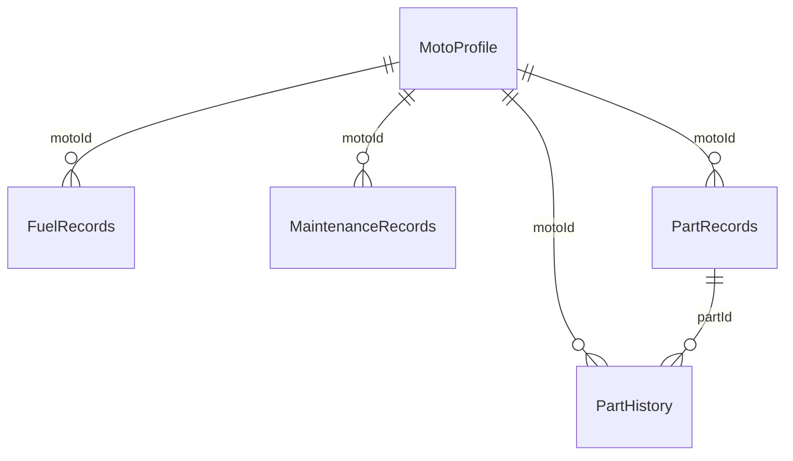

# Esquema de datos — MotoCheck

> Base local SQLite con Drift (`lib/data/database/app_database.dart`), archivo `motocheck_db`. Esquema **v10**. No hay backend: el único almacenamiento remoto es el respaldo opcional en Google Drive.

## 1. Relaciones

- Las relaciones son **lógicas**: no hay llaves foráneas en SQLite. La integridad la mantiene el código (p. ej. `deleteMoto` borra en una transacción los registros de la moto).
- `motoId` es nullable en todas las tablas por compatibilidad con datos antiguos; el código nuevo siempre lo llena.
- Solo una moto tiene `isActive = true`; todas las pantallas filtran por ella.

## 2. Tablas

### MotoProfile

| Columna | Tipo | Notas |
|---|---|---|
| id | int PK autoincrement | |
| brand, model | text | |
| year | int | |
| currentKm | int | Se actualiza solo hacia arriba (`updateMotoCurrentKmIfGreater`) |
| plate | text? | |
| engineType | text = `4T` | `4T` \| `2T` |
| twoStrokeOilMethod | text? | `autolube` \| `premix` \| null |
| displacement | int? | cc |
| fuelSystem | text = `carb` | `carb` \| `injection` |
| coolingType | text = `air` | `air` \| `liquid` |
| oilType, oilViscosity | text? | Solo 4T |
| oilFilterType | text = `replaceable` | `replaceable` \| `permanent` |
| transmissionType | text = `chain` | `chain` \| `shaft` \| `belt` |
| rimType | text = `alloy` | `alloy` \| `spoke` \| `spoke_double_wall` (filtra tipos de llanta) |
| tankCapacity | real? | litros (autonomía) |
| isActive | bool = true | Moto activa |
| updatedAt | datetime | |

### FuelRecords

| Columna | Tipo | Notas |
|---|---|---|
| id | int PK | |
| motoId | int? | → MotoProfile |
| date | datetime | |
| liters | real | |
| pricePerLiter | real? | |
| odometerKm | int | Base del cálculo km/L |
| fuelType | text | `Regular` \| `Premium` |
| usedOctaneBooster | bool = false | |
| octaneBrand | text? | |
| notes | text? | |
| isFull | bool = true | Tanque lleno; las parciales no calculan km/L |

### MaintenanceRecords

| Columna | Tipo | Notas |
|---|---|---|
| id | int PK | |
| motoId | int? | → MotoProfile |
| date | datetime | |
| odometerKm | int | Obligatorio en el formulario |
| type | text | Categoría del servicio |
| description | text | |
| cost | real? | |
| workshop | text? | |
| nextServiceDate | datetime? | Programa recordatorios |
| nextServiceKm | int? | Alerta por km |
| notes | text? | |
| oilType, oilViscosity | text? | |
| maintenanceItems | text? | Ítems separados por coma; se emparejan con refacciones |

### PartRecords

| Columna | Tipo | Notas |
|---|---|---|
| id | int PK | |
| motoId | int? | → MotoProfile |
| name | text | Único por moto al cargar refacciones comunes |
| intervalKm | int | Vida útil |
| lastChangedKm | int | |
| lastChangedDate | datetime | |
| cost | real? | |
| isActive | bool = true | |
| partCategory | text? | `oil`, `oil_filter`, `fuel_filter`, `chain`, `sprocket`, `clutch`, `engine_timing`, `valvetrain`, `engine_internal`, `gasket`, `fork`, `bearing`, `electrical`, `brake_front`, `brake_rear`, `tire`, `sealant`, `coolant`, `general`, `other` |
| filterType | text? | `replaceable` \| `permanent` (permanente = limpieza, sin alerta) |
| brakeType | text? | `pads` \| `bands` |
| tireType | text? | `standard` \| `sealant` \| `tube` \| `tubeless` |
| chainType | text? | `standard` \| `o_ring` \| `x_ring` \| `w_ring` |
| requiresComboChange | bool = false | Al cambiarla pregunta por piñón/corona |

Km restantes = `lastChangedKm + intervalKm − MotoProfile.currentKm`. Alerta si ≤ 500.

### PartHistory

| Columna | Tipo | Notas |
|---|---|---|
| id | int PK | |
| partId | int | → PartRecords |
| motoId | int? | → MotoProfile |
| partName | text | Copia del nombre (sobrevive si se renombra la pieza) |
| km | int | |
| changedAt | datetime | |
| cost | real? | |
| notes | text? | |

### AppSettings (clave/valor)

| Clave | Valor | Uso |
|---|---|---|
| `currency` | código ISO (`MXN`…) | Símbolo de moneda |
| `onboarding_done` | `true` | Ya pasó la bienvenida |
| `last_backup_time` | fecha ISO | Último respaldo en Drive |
| `notified_km_alerts` | claves separadas por coma | Alertas por km ya notificadas |

## 3. Autenticación

- **Sin cuenta por defecto.** No hay usuarios en la base.
- **Google Sign-In opcional**, scope único `https://www.googleapis.com/auth/drive.appdata`. Solo se usan nombre y correo para mostrar la cuenta conectada.
- Web: requiere `--dart-define=GOOGLE_WEB_CLIENT_ID=...`. Android: cliente OAuth con paquete `com.motocheck.motocheck` y SHA-1 de la firma (ver [RELEASE.md](../RELEASE.md)).

## 4. Respaldo en Google Drive

- Archivo único `motocheck_backup.json` en `appDataFolder` (carpeta privada, invisible para el usuario en Drive).
- `exportToJson()` serializa todas las tablas (incluye `schemaVersion`); `importFromJson()` **reemplaza** todo, incluidos los ajustes.
- Respaldo automático tras cada cambio si hay sesión; los errores se ignoran para no bloquear al usuario.

## 5. Migraciones

- **v10 es el primer esquema publicado** (`AppDatabase.firstReleasedSchemaVersion`). Desde ahí ninguna actualización borra datos.
- `onUpgrade` solo reinicia las tablas si la base viene de un esquema **< 10**, que únicamente existió en builds de desarrollo.
- Para v11 en adelante se agrega un bloque `if (from < N)` por versión, en orden (p. ej. `m.addColumn(...)`).
- `importFromJson` rechaza respaldos de un esquema **más nuevo** que la app (`UnsupportedBackupException`) y acepta los anteriores rellenando valores por defecto.

## 6. Proceso para cambiar el esquema

1. Modificar la tabla en `app_database.dart` y subir `schemaVersion`.
2. Escribir el bloque `if (from < N)` correspondiente en `onUpgrade` (nunca drop).
3. `dart run build_runner build --delete-conflicting-outputs`
4. Actualizar este documento y `exportToJson`/`importFromJson` si hay columnas nuevas.
