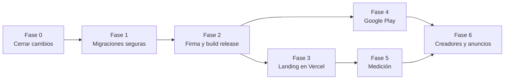

# Plan de lanzamiento — MotoCheck

> Secuencia exacta desde el estado actual (octubre 2026) hasta anuncios y creadores. Cada fase depende de la anterior: **no lanzar anuncios hacia un APK de prueba.**
>
> Responsable: **R** = Rafael, **C** = Claude (en sesión). Estado: ✅ hecho · 🔄 en curso · ⬜ pendiente.

## Dependencias

## Fase 0 — Cerrar los cambios actuales

| # | Tarea | Resp. | Estado |
|---|---|---|---|
| 0.1 | Login opcional, recordatorios, firma configurable, versión 1.0.0+3 | C | ✅ |
| 0.2 | Landing: texto corregido, `/privacidad`, analítica, atribución `utm`/`ref`, `vercel.json` | C | ✅ |
| 0.3 | Documentación del proyecto (`docs/`) | C | ✅ |
| 0.4 | Aprobar commit y push de app y landing | R | ⬜ |
| 0.5 | Probar en un teléfono real: usar sin cuenta, registrar carga/servicio/refacción, notificación de prueba | R + C | ⬜ |

## Fase 1 — Migraciones seguras (bloqueante)

Hoy un cambio de esquema borra los datos de los usuarios. Debe resolverse **antes** de que haya usuarios reales.

| # | Tarea | Resp. | Estado |
|---|---|---|---|
| 1.1 | Reemplazar el drop-all de `onUpgrade` por migraciones incrementales; v10 como base | C | ⬜ |
| 1.2 | Exportar el esquema (`drift_dev schema dump`) y agregar prueba de migración | C | ⬜ |
| 1.3 | Prueba manual: instalar 1.0.0+3, crear datos, instalar la siguiente versión, verificar que siguen | R + C | ⬜ |

## Fase 2 — Firma y build release

| # | Tarea | Resp. | Estado |
|---|---|---|---|
| 2.1 | Crear keystore de release y `android/key.properties` (ver [RELEASE.md](../RELEASE.md)); guardar copia y contraseñas fuera de la PC | R | ⬜ |
| 2.2 | Registrar SHA-1 de release en Google Cloud (cliente OAuth Android) | R | ⬜ |
| 2.3 | Compilar AAB y APK `arm64` firmados, con `GOOGLE_WEB_CLIENT_ID` | C | ⬜ |
| 2.4 | Probar login de Google y respaldo en Drive con el APK firmado | R + C | ⬜ |

## Fase 3 — Landing en producción

| # | Tarea | Resp. | Estado |
|---|---|---|---|
| 3.1 | Descargar de Manus las 3 imágenes y copiarlas a `landing/client/public/assets/` | R | ⬜ |
| 3.2 | Decidir dominio (comprar o usar uno existente) | R | ⬜ |
| 3.3 | Crear proyecto en Vercel desde el repo privado y configurar variables (`.env.example`) | C (con aprobación) | ⬜ |
| 3.4 | Publicar APK firmado en GitHub Releases del repo público y poner `VITE_APK_URL`; actualizar versión, tamaño y SHA-256 en `Home.tsx` | C (con aprobación) | ⬜ |
| 3.5 | Sitemap, URL canónica y Search Console con el dominio final | C | ⬜ |
| 3.6 | Auditoría de conversión de la landing (skills `landing-page-mastery`, `cro`) | C | ⬜ |

## Fase 4 — Google Play

| # | Tarea | Resp. | Estado |
|---|---|---|---|
| 4.1 | Cuenta de desarrollador (pago único de 25 USD) | R | ⬜ |
| 4.2 | Ficha de la tienda: título, descripciones, capturas, ícono (skill `aso`) | C | ⬜ |
| 4.3 | Formulario de seguridad de datos y URL del aviso de privacidad | R + C | ⬜ |
| 4.4 | Prueba cerrada: 12 testers durante 14 días (requisito para cuentas personales nuevas) | R | ⬜ |
| 4.5 | Producción; poner `VITE_PLAY_STORE_URL` para que la landing apunte a Play | R + C | ⬜ |

> Los testers de la prueba cerrada pueden salir de la comunidad y los primeros creadores (Fase 6), así la prueba sirve también como pre-lanzamiento.

## Fase 5 — Medición

| # | Tarea | Resp. | Estado |
|---|---|---|---|
| 5.1 | Crear propiedad GA4 y Meta Pixel; cargar los IDs en Vercel | R | ⬜ |
| 5.2 | Verificar el evento `app_download` con `utm`/`ref` en GA4 DebugView | C | ⬜ |
| 5.3 | Decidir si la app lleva analítica propia (activación/retención) y actualizar el aviso de privacidad | R | ⬜ |
| 5.4 | Definir metas: CPI objetivo, % activación, retención a 30 días (ver [PRD §8](01-PRD.md#8-métricas-de-éxito)) | R + C | ⬜ |

## Fase 6 — Creadores y anuncios

| # | Tarea | Resp. | Estado |
|---|---|---|---|
| 6.1 | Contexto de marketing del producto (skill `product-marketing`) a partir del PRD | C | ⬜ |
| 6.2 | Página para creadores con código de referido (`?ref=`) y brief | C | ⬜ |
| 6.3 | Lista de creadores de motos (micro, 10k–100k, México primero), mensaje de contacto y acuerdo (skill `influencer-marketing`) | C + R | ⬜ |
| 6.4 | Guiones de video corto y textos de anuncios (skills `social`, `ad-creative`) | C | ⬜ |
| 6.5 | Campaña piloto de bajo presupuesto en Meta/TikTok, dirigida a Play Store | R | ⬜ |
| 6.6 | Revisión semanal: costo por instalación por creador y por anuncio; escalar lo que funcione | R + C | ⬜ |

## Reglas para cada release

1. Subir `version` en `pubspec.yaml` (el número tras `+` siempre crece).
2. `flutter analyze` y `flutter test` limpios.
3. Revisar que la landing no prometa nada fuera del [PRD](01-PRD.md).
4. Actualizar `ESTADO.md` y los documentos de `docs/` que cambien.
